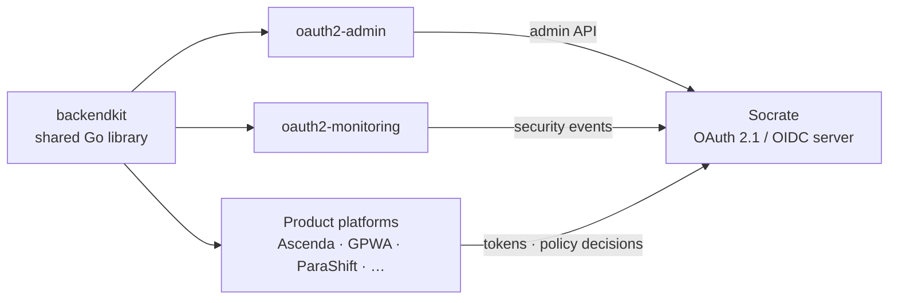

# Olivier Vandermoten

**Founder, Garnet & Jade Consulting · Montpellier, France** 
Telecom executive turned builder: I design and ship production B2B SaaS myself, from the identity layer to the product UI.

> *A digital-transformation advisor must also be a digital builder.*

---

## About

- **30+ years in mobile telecom** across Europe and Africa, including executive and P&L roles at Ericsson leading teams of 600+ people and key-account management for major operators.
- **Deep-tech founder:** created **Lichens**, a printed-electronics startup bringing affordable, passive indoor mobile coverage to SMEs, selected for Orange Fab France's 5G cohort.
- **Today:** I run Garnet & Jade Consulting and build a portfolio of vertical SaaS platforms on one shared foundation: a self-hosted identity provider, a common Go library, and the same Go + Vue 3 stack everywhere.
- Engineer by training (Ir.), bilingual French / English.

---

## 🔐 The foundation — Socrate identity suite

Every platform I build signs users in through **Socrate**, my own OAuth 2.1 / OpenID Connect server written in Go. It runs in production today; the server repository is being prepared for public release, and the surrounding tooling is already open source.

**Socrate server** *(v1.4, Apache-2.0, public release in preparation)* 
Authorization Code + PKCE only, OIDC discovery/JWKS, refresh-token rotation with reuse detection, DPoP (RFC 9449), token exchange (RFC 8693), introspection and revocation, TOTP MFA, magic links, per-app RBAC, a loopback-only admin API, hash-chained tamper-evident audit, auto-defense and GeoIP analytics. Four internal security audit passes with every finding closed; CI gates on `-race`, `govulncheck`, lint and a coverage ratchet. New controls ship *observe → enforce*, never as a flag day.

| Open-source repo | What it does | Stack |
|---|---|---|
| [**backendkit**](https://github.com/ovander/backendkit) | Shared Go library for every service that trusts Socrate: RS256/JWKS validation, Backend-for-Frontend runtime, central policy enforcement (PEP), middleware, plan gating, AI provider gateway. | Go · chi · Prometheus |
| [**oauth2-admin**](https://github.com/ovander/oauth2-admin) | Superadmin console: applications, users, security, access policy, step-up re-authentication. | Vue 3 · Go BFF |
| [**oauth2-monitoring**](https://github.com/ovander/oauth2-monitoring) | Security operations console: live SSE event stream, threats, geo analytics, alert rules, IP blocking. | Vue 3 · Go BFF |

---

## 🧩 Products built on it

### Open source

**📈 Ascenda — financial planning for startups and SMEs** · [backend](https://github.com/ovander/ascenda-backend) · [frontend](https://github.com/ovander/ascenda-frontend) · AGPL-3.0 
A "financial operating system": multi-year P&L, cash flow and balance sheet, scenarios, cap table, break-even and AI narration grounded in the live model. Business-model aware (SaaS, consulting, marketplace, manufacturing, media, training). Deterministic Go compute engine with no I/O; AI explains the numbers, it never computes them.

**⛵ Vigie — AIS watch for Home Assistant** · [ha-vigie](https://github.com/ovander/ha-vigie) 
Reads a boat's AIS receiver over NMEA 0183 and exposes own position, surrounding traffic and CPA/TCPA collision-risk alerts as Home Assistant entities. Local only, no cloud. *Pre-alpha — an aid to watchkeeping, not a collision-avoidance system.*

### In private development

**📡 DTMA — Digital Transformation Maturity Assessment** · *my founding platform* 
Where thirty years of telecom meet the builder side: a TM Forum-aligned maturity assessment platform for mobile operators. Version 2.0 runs recurring assessments, a survey lifecycle (draft → published → closed → archived), collaborative expert assignments, domain benchmarks and asynchronous AI report generation. Go + Vue 3.

On top of it sits **Evidence Loop**, the Garnet & Jade offer that helps operators choose high-value scenarios that fit their actual maturity, in four steps: **See → Understand → Decide → Act**. A unified KPI framework keeps definitions consistent across operators, and one rule holds throughout: *a KPI score is not a maturity level* — the two lenses are read side by side.

| Platform | Domain | Highlights |
|---|---|---|
| **GPWA** — Golf Performance & Wellness Analytics | Sports performance | Players, coaches and fans; round lifecycle with voice debrief, strokes-gained analytics, decision engine, wearable physiology, mental-performance tracking. ~700 API routes, OpenAPI-documented. Go + TypeScript. |
| **ParaShift** | Retail health / workforce | Rule-driven, AI-assisted shift scheduling and compliance for multi-store parapharmacy networks. Go + TypeScript. |
| **Poolside** | IoT | Self-hosted pool telemetry reading a Flipr probe directly over Bluetooth LE, no cloud; pure, dependency-free chemistry and decode packages. Go + TypeScript. |

---

## Engineering principles

- **No tokens in the browser.** Every web app runs behind a Go Backend-for-Frontend: server-side sessions, `__Host-` cookies, PKCE, CSRF checks, fail-closed proxying.
- **Standards first.** If an RFC defines it, follow the RFC.
- **Solve security once.** Token validation, policy enforcement and service plumbing live in one versioned library, so a fix lands everywhere.
- **Observe before enforce.** Prove parity, then turn it on. No flag days.
- **Deterministic core, AI as a layer.** Pure compute packages; AI narrates, reviews and suggests.
- **Multi-tenant by design.** Data scoped by tenant from the first migration.
- **Local-first where it matters.** Pools and boats don't need a cloud to work.
- **Documented like a product.** Specs, architecture references, changelogs and runbooks written for the next engineer.

---

## Toolbox

**Backend** Go · chi · GORM · PostgreSQL · golang-migrate · Prometheus · logrus 
**Frontend** Vue 3 · TypeScript · Vite · Pinia · PrimeVue · Tailwind CSS · Chart.js 
**Identity & security** OAuth 2.1 · OpenID Connect · DPoP · JWT/JWKS · BFF pattern · RBAC/ABAC · govulncheck 
**AI** OpenAI · Claude · Ollama behind one gateway, with a language guard for French/English output 
**Testing & ops** testify · testcontainers-go · fuzz & adversarial suites · GitHub Actions · Docker · Caddy 
**IoT** Home Assistant · NMEA 0183 / AIS · Bluetooth LE · MQTT

---

Open-source licences: Apache-2.0 (Socrate suite, backendkit) · AGPL-3.0 (Ascenda).
